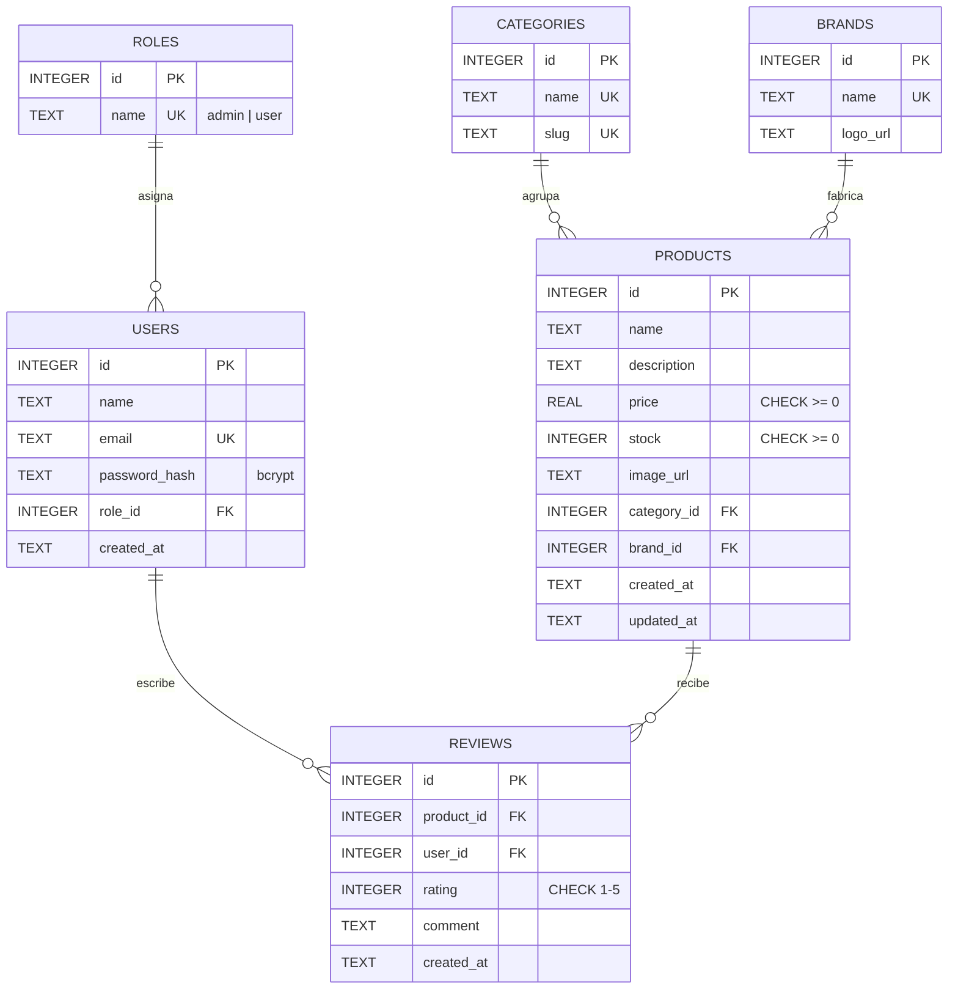

# Esquema de base de datos: TechStore

Motor: **SQLite** (módulo nativo `node:sqlite`). Definición completa en [`src/db/schema.sql`](../src/db/schema.sql).

## Diagrama entidad-relación

## Tablas

| Tabla | Propósito | Relaciones |
|---|---|---|
| `roles` | Catálogo de roles (`admin`, `user`) | 1:N con `users` |
| `users` | Cuentas de usuario con contraseña hasheada | N:1 con `roles`, 1:N con `reviews` |
| `categories` | Categorías del catálogo (laptops, audio…) | 1:N con `products` |
| `brands` | Marcas fabricantes | 1:N con `products` |
| `products` | Productos a la venta | N:1 con `categories` y `brands`, 1:N con `reviews` |
| `reviews` | Reseñas de usuarios sobre productos (resuelve la relación N:M usuarios↔productos) | N:1 con `products` y `users` |

## Normalización (3FN)

- **1FN:** todos los atributos son atómicos (no hay listas ni campos repetidos) y cada tabla tiene llave primaria.
- **2FN:** todas las llaves primarias son simples (`id`), así que no puede haber dependencias parciales.
- **3FN:** no hay dependencias transitivas:
  - El nombre del rol vive en `roles`, no en `users`. `users` solo guarda `role_id`.
  - El nombre y slug de la categoría, y el nombre de la marca, viven en sus propias tablas. `products` solo guarda `category_id` y `brand_id`.
  - La calificación promedio de un producto **no se almacena**: se calcula con `AVG(reviews.rating)` al consultar, para evitar datos derivados que puedan quedar inconsistentes.

## Integridad

- `PRAGMA foreign_keys = ON` en cada conexión.
- `ON DELETE RESTRICT` en `products → categories/brands`: no se puede borrar una categoría o marca con productos asociados.
- `ON DELETE CASCADE` en `reviews`: al borrar un producto o un usuario se eliminan sus reseñas.
- `UNIQUE (product_id, user_id)` en `reviews`: un usuario solo puede reseñar un producto una vez.
- Restricciones `CHECK` en precio, stock y calificación.
- Índices en las llaves foráneas más consultadas (`products.category_id`, `products.brand_id`, `reviews.product_id`).
